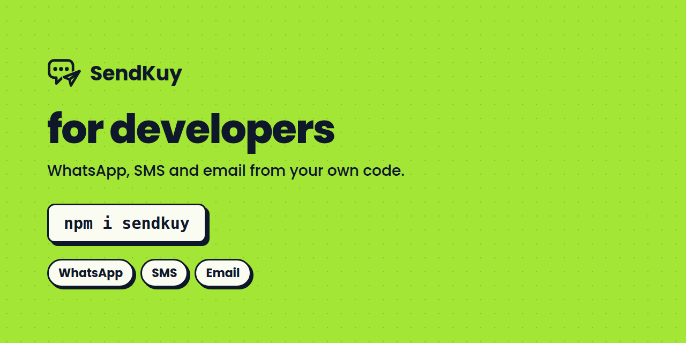

  

## Send WhatsApp, SMS and email from your own code

SendKuy gives you one API key, one set of endpoints and three channels. Connect WhatsApp by scanning a QR code, through the Cloud API or with our Chrome extension; send SMS from your own Android phone or a provider; send email through your own domain.

| Package | Install | |
| --- | --- | --- |
| [sendkuy-node](https://github.com/sendkuy/sendkuy-node) | `npm i sendkuy` | Node.js, Bun, Deno, edge |
| [sendkuy-php](https://github.com/sendkuy/sendkuy-php) | `composer require sendkuy/sdk` | any PHP 8.2+ project |
| [sendkuy-laravel](https://github.com/sendkuy/sendkuy-laravel) | `composer require sendkuy/laravel` | notifications, facade, webhooks |

- [sendkuy.com](https://sendkuy.com/?utm_source=github&utm_medium=profile&utm_campaign=sendkuy)
- [Documentation](https://docs.sendkuy.com/?utm_source=github&utm_medium=profile&utm_campaign=sendkuy)
